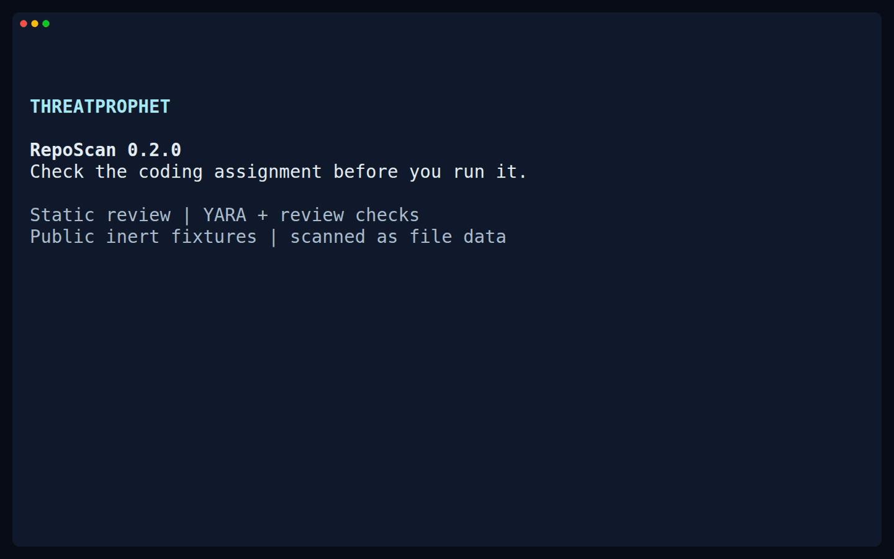

# ThreatProphet RepoScan

**Check the coding assignment before you run it.**

[](https://github.com/ThreatProphet/RepoScan/actions/workflows/ci.yml?query=branch%3Amain)


[](LICENSE)

Received a take-home assignment, interview project, or unfamiliar repository?
RepoScan checks its local files for suspicious execution triggers, concealed
code, and patterns observed in developer-targeted attacks. Use it before
trusting the workspace, installing dependencies, or starting the project.

**Built from [ThreatProphet investigations](https://threatprophet.com/).**
Report-derived YARA rules work alongside broader static review checks, so an
unusual hook or obfuscated construct can warrant inspection even when the full
execution chain is unresolved. Scanning reads the supplied files as data.

[Quick start](#quick-start) · [Example finding](#see-an-example-finding) ·
[Detection coverage](docs/detections.md) · [Contribute](#help-improve-detection)

## Quick start

**Version 0.2.0, Linux, Python 3.10 or later.** Install the trusted scanner
from the tagged release checkout.

With Git and [pipx](https://pipx.pypa.io/latest/how-to/install-pipx.html) installed,
and pipx's application directory on your `PATH`:

```bash
git clone --branch v0.2.0 --depth 1 https://github.com/ThreatProphet/RepoScan.git
cd RepoScan
pipx install '.[yara]'
reposcan --version
reposcan /absolute/path/to/received-project
```

Pipx keeps the scanner in its own environment. The `[yara]` extra installs the
engine used by the default scan. For setup without pipx, the same checkout
includes an installer:

```bash
bash ./install.sh
```

It creates a dedicated environment, verifies a benign scan with YARA, and
prints the command path and removal instructions. See the
[installation guide](docs/installation.md) for prerequisites, custom paths,
the manual virtual-environment option, upgrades, and existing-installation
conflicts.

The scan does not install the target's dependencies, invoke its hooks or setup
commands, evaluate decoded source, or retrieve payload URLs. It requires no
account, source upload, or LLM API key. Installing RepoScan and its dependencies
is a separate step that can use the network.

The distribution is named `threatprophet-reposcan`; the command remains
`reposcan`. The package has not been published to PyPI; use the release-checkout
instructions above. The unrelated `reposcan` package on PyPI is not this project.

## Watch a scan



The demo scans public fixtures as file data. The Web3Market example produces
three findings across two files and a `review-needed` result with exit code `1`.
A scan with no findings is not a guarantee of safety.

[Recording source](docs/demo.tape) ·
[Full text result](examples/web3market.txt) ·
[Web3Market case study](docs/web3market.md)

## See an example finding

Try the reduced Web3Market fixture included in this checkout:

```bash
reposcan tests/fixtures/web3market-entry --color never
```

Selected output from the real CLI, with other lines omitted:

```text
Verdict:  review-needed
Findings: 3
Scanned:  2/2 selected files

HIGH
  - TP_DevelTask_Node_InlineArray_Remote_Execution
    path:   controllers/users.js.fixture
    source: yara-python
    review: report-pattern; confidence medium
    why:    Web3Market-style inline-array import, character-decoded fetch, JSON token extraction, and call context coexist
    match:  $import at line 3, byte 191 (23 bytes)
    report: TP-2026-018
```

Exit `1` is expected because the fixture produces review findings. Its two
`.fixture` files are scanner input, with an `example.invalid` destination and
no installable target manifest. Read the [Web3Market case study](docs/web3market.md)
to follow the investigation, detection choice, tests, and known limits.

Full example reports: [text](examples/web3market.txt) ·
[JSON](examples/web3market.json) · [Markdown](examples/web3market.md).

## What it checks

| Review area | Examples | What to inspect |
| --- | --- | --- |
| Editor and repository triggers | VS Code folder-open tasks, supplied Git hooks, command-capable Git configuration, package lifecycle scripts | Which developer action can activate the command, and what it invokes |
| Concealed content | Character-code arrays, encoded strings and commands, string tables, long whitespace gaps | What the concealment hides and how that content is used |
| Risky code combinations | Download-and-execute patterns, dynamic evaluation, environment and credential collection constructs | The input source, execution context, and intended behavior |
| Report-derived patterns | Tested combinations from ThreatProphet developer-task investigations, including Web3Market | How the observed source relates to a documented mechanism |

All current ThreatProphet report-derived detections come from investigations
of developer-task attacks. The checks also apply to unfamiliar projects shared
outside a recruitment process. Independent research and well-supported new
patterns are welcome contributions.

The [detection guide](docs/detections.md) links the actual rules and explains
what each check establishes. A useful warning does not require a confirmed
malware-family match or actor attribution.

## Why this exists

A plausible coding assignment can put attacker-controlled code into a normal
development workflow. Microsoft's
[Contagious Interview research](https://www.microsoft.com/en-us/security/blog/2026/03/11/contagious-interview-malware-delivered-through-fake-developer-job-interviews/)
describes malicious interview packages and editor tasks, and recommends
reviewing recruiter-provided repositories before installation or execution.

ThreatProphet turns investigations of this problem into inspectable rules,
inert test cases, and findings that show developers where to look. The
[Web3Market example](docs/web3market.md) makes that process reproducible.

## Read the result

A finding gives you the file, the reason for review, severity, confidence,
available trigger prerequisites, and exact byte locations. JSON and Markdown
also include file hashes and stable finding IDs. Source snippets and decoded
destinations are omitted from reports.

**Severity** expresses potential impact or review urgency. **Confidence**
expresses the strength of the matched evidence. Legitimate tooling can use
risky mechanisms, so a warning calls for inspection of the surrounding code.

| Exit | Result | Next step |
| --- | --- | --- |
| `0` | No findings in the files selected by the scan policy | Check coverage and apply your normal review process |
| `1` | Review warnings, or explicit Lite heuristic findings | Inspect the flagged files and prerequisites before proceeding |
| `2` | A YARA finding with critical severity and high confidence | Pause and investigate the identified behavior |
| `64`, `69`, `70` | Configuration, engine, or operational failure | Resolve the error; the result is not a completed clean scan |

**No findings is not a guarantee of safety.** Review the coverage and any
unresolved-analysis warnings. The default policy skips dependency/build
folders, symlinks, special files, and oversized files, while retaining supplied
`.git/hooks` and `.git/config` for inspection. A complete scan means the eligible
set was processed, not that every byte or execution path was understood.

See [design and scope](docs/design.md) for the read boundary, resource limits,
trigger prerequisites, platform support, and result schema.

## Save a report

Write reports outside the scanned target directory:

```bash
reposcan /absolute/path/to/received-project --format markdown > review.md
reposcan /absolute/path/to/received-project --format json > review.json
```

The default engine selects `yara-python`, then the YARA CLI. If neither is
available it fails explicitly. To select an engine:

```bash
reposcan /absolute/path/to/received-project --engine yara-python
reposcan /absolute/path/to/received-project --engine yara-cli
reposcan /absolute/path/to/received-project --engine lite
```

Lite is an explicit heuristic mode with its own findings. Shared `REVIEW_*`
checks run with every engine. Use `--help` for options and `--version` when
reporting a problem. `--json`, `--lite`, and the existing Python/Bash entry
points remain available; the Bash wrapper uses `python3` from `PATH`.

## Help improve detection

You do not need to write a YARA rule to contribute:

- **Found a noisy warning?** Share the rule ID and a small benign example that
  helps distinguish intentional behavior from a suspicious use.
- **Found a missed pattern?** Describe the trigger or concealment mechanism and
  link public research or provide a reduced inert example.
- **Want a small code contribution?** Add a close benign comparison, a supported
  syntax variation, or a clearer explanation for an existing finding.
- **Tried the tool?** Report installation friction or unclear output, including
  the scanner version, engine, and platform.

Start with [CONTRIBUTING.md](CONTRIBUTING.md), which explains the relevant
files, local checks, and detection expectations. Use
[Issues](https://github.com/ThreatProphet/RepoScan/issues) for bugs, detection
gaps, and false positives. For vulnerabilities in the scanner itself, follow
[SECURITY.md](SECURITY.md).

Keep public examples small and sanitized. Do not execute a suspicious project
to prepare a contribution, or attach private repositories, live payloads,
credentials, or personal data to a public issue.

## Project status and documentation

Version 0.2.0 supports Linux. Native Windows is unsupported and macOS needs
native verification. General data-flow analysis, remote repository acquisition,
and broader platform support are not current features.

Project-owned code, original rules, tests, and documentation are licensed under
[MIT](LICENSE). Dependencies and any third-party material retain their own
licenses and notices. Linked investigations remain subject to their
publishers' terms.

- [Installation and maintenance](docs/installation.md)
- [Detection guide](docs/detections.md)
- [Design and trust boundary](docs/design.md)
- [Web3Market case study](docs/web3market.md)
- [Contribution guide](CONTRIBUTING.md)
- [Security reporting](SECURITY.md)
- [Changelog](CHANGELOG.md)
