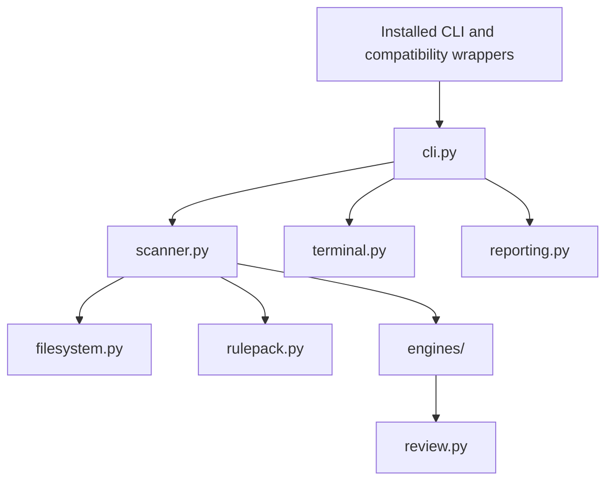

# Code architecture

RepoScan separates scan execution from command-line presentation. The central
boundary is `scan(ScanOptions) -> ScanResult`: it accepts explicit inputs,
performs a bounded review, and returns a result without printing or reading
command-line arguments.

This guide explains where changes belong. [Design and scope](design.md)
documents the trust boundary, supported platforms, coverage, and output contract.

## Main dependencies



Shared records live in `models.py`, defaults and explicit limits in
`settings.py`, and deterministic ordering and verdicts in `results.py`.
`engine_support.py` provides bounded matching and trusted rule metadata parsing.
These supporting modules do not depend on the CLI or terminal renderer.

The installed command, `python -m reposcan`, and the source-checkout Python
wrapper enter through `cli.main`. `scanner.main` is a small compatibility
delegate for existing callers. Its local CLI import runs only when that legacy
entry point is invoked. Normal service calls do not import the presentation
layer.

## Module responsibilities

| Module | Owns | Boundary |
| --- | --- | --- |
| `cli.py` | Arguments, compatibility flags, usage errors, output selection, process exit status | Converts arguments into scan options, then renders the returned result |
| `scanner.py` | Setup order, engine selection and preparation, scan orchestration, expected setup failures | Returns `ScanResult`; does not print or parse arguments |
| `models.py` | Options, findings, evidence, errors, statistics, discovered-file identities, result records | Data shared across the scan pipeline |
| `settings.py` | Packaged resource locations, defaults, severity order, explicit limits and exit constants | Configuration values without scan execution |
| `filesystem.py` | Ignore matching, bounded discovery, anchored opens, identity checks, read budgets | Owns access to untrusted target paths |
| `rulepack.py` | Trusted rule selection, bounded snapshots, rule-pack identity | Keeps metadata, hashes, and compilation on the same captured rule bytes |
| `engines/yara_python.py` | Python YARA matching, evidence extraction, runtime warning handling | Uses captured target bytes and returns findings/errors |
| `engines/yara_cli.py` | Bounded native process output, diagnostics, validation, captured-file scanning | Invokes the trusted YARA executable against a private copy of captured bytes |
| `engines/lite.py` | Explicit Lite patterns and heuristic matching | Produces separately labeled heuristic findings |
| `engines/common.py` | Finding metadata conversion, stable finding identity, documentation confidence adjustment, read-error accounting | Shared adapter behavior |
| `engine_support.py` | Matching deadlines and bounded rule metadata parsing | Existing engine support primitives |
| `review.py` | Bounded inspection of configuration, triggers, and obfuscation | Bytes and display path in; findings out; no target I/O |
| `results.py` | Verdict calculation, stable ordering, original rule paths in errors | Finalizes the result before temporary rule snapshots are released |
| `reporting.py` | Versioned payload construction and Markdown rendering | Serializes an already completed result |
| `terminal.py` | Color, escaping, wrapping, finding layout, and coverage display | Presents existing records without scanning files |

The engine package uses ordinary modules and explicit calls. A new detector
usually belongs in the rule pack or common review checks, so it does not require
an engine abstraction or registration framework.

## Scan lifecycle

The order of these steps affects observable errors and coverage. Preserve it
when changing orchestration:

1. The CLI parses arguments and resolves compatibility-option conflicts.
2. The service normalizes the target with `abspath`, then validates its type.
   It does not resolve target symlinks.
3. The service reads the trusted ignore configuration and records its hash.
4. Canonical modes select and capture trusted rules, parse their metadata, and
   compute the rule-pack identity. Lite bypasses rule-pack preparation.
5. The filesystem layer discovers eligible files and records coverage.
6. The service selects the engine and compiles or validates the captured rules.
7. The adapter reads each selected file through the bounded reader, matches its
   captured bytes, and runs the common review checks within the same deadline.
8. The service combines discovery and engine errors, determines completion and
   verdict, orders the records, and restores original rule paths in errors.
9. The CLI renders the completed result and returns its exit code.

Discovery happens before engine availability is checked. An unavailable engine
therefore retains discovery statistics. A native binding that fails to load
produces an explicit failure; automatic selection does not hide that failure by
switching to another engine.

Expected setup failures are translated into structured failed results.
Per-file failures are retained by the adapter, including findings accumulated
before a later failure. A partial scan always has an operational-failure exit
status, even when its finding verdict remains visible.

## Working with the service boundary

Within RepoScan development, callers can inspect a result without capturing
terminal output or changing `sys.argv`:

```python
from pathlib import Path

from reposcan.models import ScanOptions
from reposcan.scanner import scan

result = scan(ScanOptions(target=Path("/path/to/received-project")))

for finding in result.findings:
    print(finding.severity, finding.path, finding.rule)

if not result.complete:
    for error in result.errors:
        print(error.code, error.message)
```

`ScanOptions` validates engine names and positive integer limits. Color,
wrapping width, and output format belong to the CLI, so they are absent from
scan options. Expected scan failures are returned as records. Unexpected
programming errors are not converted into a successful or empty scan.

Use the supported Linux main-thread environment for matching deadlines, as
described in [design and scope](design.md). This internal Python interface is
not a separately versioned SDK. The documented command-line entry points and
versioned JSON schema remain the compatibility surfaces. Internal helpers
formerly imported from `scanner.py` now live in their owning modules.

## Where to make a change

| Intended change | Start here | Useful verification |
| --- | --- | --- |
| Add a report-derived YARA signature | `src/reposcan/rules/` and `docs/detections.md` | Exact IDs, inert positives, close benign cases, both canonical adapters |
| Add a common trigger or obfuscation check | `review.py` | `tests/test_review.py`, including bounds and no target I/O |
| Add or refine a Lite pattern | `engines/lite.py` | Heuristic labels, near misses, bounded matching, separate verdict semantics |
| Change file selection or read handling | `filesystem.py` | Filesystem, race, growth, partial-read, and resource-limit tests |
| Change a CLI option | `cli.py`; add a `ScanOptions` field if it changes the scan | CLI validation, aliases, service behavior, help and installed entry points |
| Change colors or text layout | `terminal.py` | Terminal escaping, plain/color equivalence, widths, examples and demo |
| Change structured reports | `reporting.py` and the JSON schema when applicable | Determinism, schema validation, byte evidence, Markdown escaping |
| Add a matching engine | `engines/` and scanner selection/preparation | Explicit availability failure, budgets, partial results, evidence and provenance |

The new service tests are in `tests/test_scanner.py`. Existing tests patch the
module that owns the operation, such as `filesystem.discover_files` or
`engines.yara_cli.run_yara_cli`. They do not load a second copy of the scanner
module to reach unrelated helpers.

## Invariants to preserve

- All engines use the anchored reader for target data. Symlinks and special
  files remain outside the read boundary, and discovered device/inode identity
  is checked again before reading.
- Actual bytes read consume the shared budget, including bytes from a read
  that later fails. A file counts as scanned only after matching and common
  review finish successfully.
- Matching and common review share the per-file deadline. Keep partial findings
  that were accumulated before a later error.
- YARA Python runtime warnings make the result incomplete. The warning flag
  remains necessary even if native bindings swallow callback exceptions.
- Native CLI output has a combined stdout/stderr cap. Exceptional exits kill
  and wait for the process. Temporary captured-source paths do not appear in
  public diagnostics.
- Rule metadata, identity, namespaces, and compilation refer to the same
  captured rule pack throughout a scan. Error messages restore original trusted
  rule paths before the snapshots are cleaned up.
- Severity and confidence remain separate. A strong canonical verdict requires
  the documented severity, confidence, and source combination. Lite never
  silently substitutes for canonical YARA.
- Output contains evidence locations and hashes, without source snippets or
  decoded payload content. Terminal and Markdown escaping remain independent
  presentation responsibilities.

Changes to these behaviors need an explicit behavioral proposal and regression
evidence. A structural refactor should preserve findings, verdicts, exit codes,
coverage, and all supported output formats. See [CONTRIBUTING.md](../CONTRIBUTING.md)
for the complete verification and installation checks.
