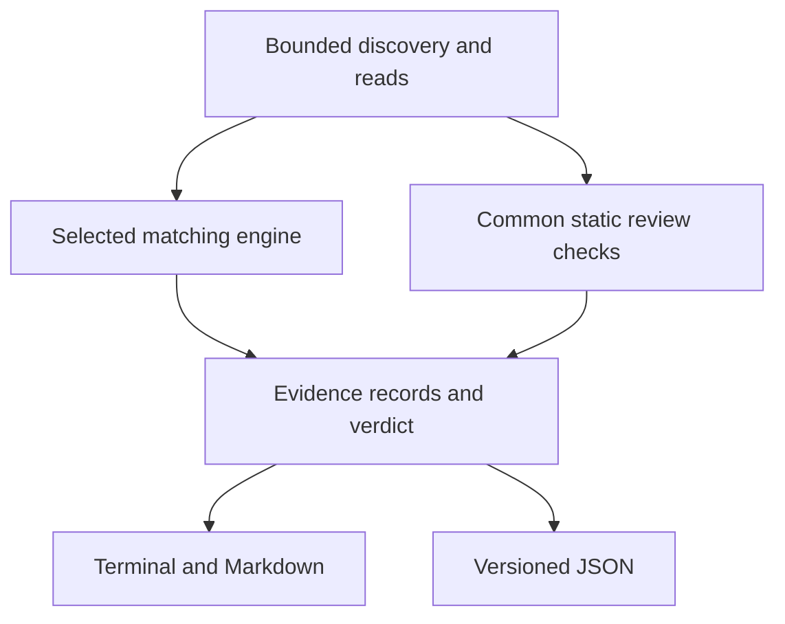

# Design and scope

## The developer's decision

RepoScan reviews an unfamiliar local tree before the developer enables its
workspace features, installs dependencies, or runs project commands. It surfaces
reasons to inspect the project. It is useful even when source behavior cannot be
fully resolved or associated with a known malware family.

The scanner does not certify a repository as safe. Remote dependencies and
downloaded stages that are not present in the input cannot be inspected. Static
relationships do not establish that a trigger executed or an attack succeeded.

## Trust boundary

The scanner, its Python/YARA dependencies, and explicitly selected rules and
configuration are trusted tooling. Target files, names, and metadata are
untrusted input.

The core scan:

- Reads local files and interprets supported configuration as data.
- Does not invoke Git against the supplied repository metadata.
- Does not install target dependencies, run lifecycle hooks, start the
  application, or run its build or tests.
- Does not evaluate target JavaScript or shell commands to decode content.
- Does not retrieve a network destination found in the target.

Literal decoding is limited to supported, bounded forms. Unsupported syntax
remains unresolved; the absence of a decoded result is not a safety claim.
A supported warning can remain useful without resolving the final behavior.
Rules and ignore configuration must be selected by the analyst rather than
automatically trusted because the target supplies them.

## Architecture

`scanner.scan` accepts typed options and returns a structured result without
printing. The CLI owns argument parsing and presentation; separate modules own
bounded filesystem access, rule snapshots, engine adapters, result finalization,
and renderers. The [code architecture guide](architecture.md) maps those
responsibilities, their dependencies, and the tests relevant to each change.

The installed command, package-module invocation, and Python/Bash wrappers
delegate to `cli.main`. `scanner.main` remains a compatibility delegate.

Canonical YARA and Lite are different matching implementations. Common review
checks augment both. YARA failure does not silently select Lite. Matching and
observation sources remain identifiable in each result.

Both canonical adapters assign the same per-file YARA namespaces, keeping
global-rule scope consistent across the Python and CLI engines. Trusted rule
files are captured once into private temporary copies. Metadata parsing,
per-file hashes, the rule-pack digest, and compilation use those captured bytes.
Later edits to the original rule files therefore cannot change which rules are
compiled during that scan. Reported rule errors use the original source paths.

## File handling and resource bounds

Discovery uses filesystem metadata and no-follow access. Reads verify the
discovered file identity and reject an entry that changes to a different inode
or special file. Byte accounting includes the actual bytes read, including
partially failed reads. Directory entries and results are sorted.

| Option | Default | Meaning |
| --- | ---: | --- |
| `--max-size` | 2,097,152 bytes | Largest eligible individual file |
| `--max-files` | 10,000 | Maximum selected files |
| `--max-entries` | 100,000 | Maximum visited filesystem entries |
| `--max-total-bytes` | 268,435,456 bytes | Aggregate read budget |
| `--timeout` | 30 seconds | Per-file matching deadline, including common review |

The matching deadline is not a total job deadline. Supported deadline handling
depends on the main-thread POSIX CLI environment. Linux is the supported
baseline. macOS requires native verification of the filesystem and timer
primitives; native Windows is unsupported.

The scanner resists path replacement but does not freeze the entire directory
tree. A file can be edited in place during a scan. A finding's SHA-256 identifies
the captured bytes used for matching, not a filesystem-wide consistent snapshot.
Use an immutable copy for evidence work.

## Coverage and completeness

The default ignore configuration is packaged at
[`src/reposcan/config/scan_ignore.txt`](../src/reposcan/config/scan_ignore.txt).
It excludes bulky dependency/build directories and Git objects/logs/references,
without excluding all of `.git`.

Policy skips such as ignored paths, oversized files, symlinks, and special files
do not make the run incomplete. Read failures, scan-budget breaches, matching
timeouts, and engine failures do. Consequently `complete: true` means the
configured eligible set was processed. It does not mean every input byte was
scanned or every construct understood.

YARA runtime warnings can indicate omitted matches and make the scan incomplete
with exit code `70`. Recognized CLI compiler performance warnings are allowed;
they are distinct from matching diagnostics that can affect result completeness.

Common review has additional analysis bounds. Reaching one can produce
`REVIEW_Analysis_Limit` while the scan remains operationally complete. A
configuration that cannot be parsed within the supported syntax and bounds
produces `REVIEW_Configuration_Unparsed`. Both are reasons for manual review,
not evidence that all relevant behavior has been resolved.

| Common review bound | Limit |
| --- | --- |
| Bytes inspected per file | First 2 MiB, even if `--max-size` is raised |
| JSON/JSONC configuration | 256 KiB; nesting depth 32; 4,096 values; 32 KiB per string |
| Supported literal arrays | 8 KiB per candidate; 1,024 values; 128 candidates per array-check pass |
| Review observations | At most 64 ordinary observations plus an analysis-limit warning per file |

Coverage uses counters in `stats`, the scope statement in `coverage.scope`,
and a bounded list of skipped paths and reasons in `coverage.skipped`.
`coverage.skipped_truncated` states whether that list was truncated. A pruned
directory counts as a pruned entry; the scanner has not enumerated every
descendant to count excluded files. Review skips even when the verdict is
`no-findings`, particularly if no file was scanned.

Use `--ignore-config /path/to/reviewed-policy.txt` to select a different policy.
Making scope broader is an explicit choice with resource bounds, not evidence
that excluded directories are safe. `--rules /path/to/reviewed-rules` similarly
selects a trusted rule directory.

## Trigger prerequisites

A trigger declaration and an activated trigger are different observations.
Findings explain the applicable action and any unresolved conditions.

- [VS Code automatic tasks](https://code.visualstudio.com/docs/debugtest/tasks#_control-automatic-task-execution)
  depend on workspace trust and automatic-task settings. Folder-open tasks do
  not run in an untrusted workspace.
- [Git hooks](https://git-scm.com/docs/githooks) depend on the hook event,
  configured hooks path, and executable state. The scanner may not establish all
  of those conditions from one file.
- Git does not normally copy another repository's local hooks/configuration
  during cloning. An archive can supply untrusted `.git` metadata. Git's
  [security documentation](https://git-scm.com/docs/git#_security) explains why
  running Git commands against that metadata can itself be unsafe.

A supplied `.git` file containing a `gitdir:` pointer is reported without
following that pointer. Git configuration includes and redirected hook paths
also require review of their destinations; the trigger check does not open
those destinations on the basis of untrusted configuration.

## Output contract

### Terminal presentation

Text output starts with the verdict, finding and severity counts, and scan
status. Each finding leads with its severity and file location, followed by the
reason, applicable trigger prerequisites, and up to four evidence locations.
The full rule ID, category, confidence, engine source, and report references
remain available below the evidence. The location suffix uses the earliest
recorded evidence line; the individual matches retain their exact positions.
Additional recorded locations and collection limits are identified separately.

Severity badges use the terminal's magenta, red, yellow, and blue palette for
critical, high, medium, and low. Paths and evidence line numbers use cyan;
YARA string identifiers use magenta. These are standard ANSI palette colors,
so their exact appearance follows the user's terminal theme. Labels and
ordering preserve the meaning when color is unavailable. No runtime rendering
dependency is required.

`--color auto` uses color only on a terminal when `NO_COLOR` is absent.
`--color always` and `--color never` explicitly override automatic selection.
Untrusted text is escaped before wrapping or applying style; filenames and
rule metadata cannot inject terminal control sequences through this renderer.

Text uses the terminal width up to 120 columns, or 100 columns for redirected
output. `--width N` fixes the width between 40 and 240 columns. Continuation
lines retain their field indentation; long tokens are split without truncation.
Path fields preserve leading, trailing, and repeated spaces when wrapping.
The width calculation accounts for wide and combining characters, although
exact glyph rendering depends on the terminal and font. These options do not
change JSON or Markdown output. Use those formats for structured consumption;
the text layout may evolve.

### Structured evidence

JSON has `schema_version: "1.0"` and a packaged
[schema](../src/reposcan/schemas/result.schema.json). It records tool and engine
versions, rule-pack identity, effective policy, coverage, status, findings,
errors, and statistics. The result is deterministic for the same captured
bytes, paths, engine versions, and configuration; volatile timestamps and
durations are not mixed into its core.

Evidence offsets are zero-based byte offsets in the scanned representation;
line numbers are one-based. Evidence entries contain `identifier`, `offset`,
`length`, and `line`. Lists are bounded, with `evidence_truncated` indicating
reported truncation. `finding_id` is derived from the rule ID, relative path,
file hash, and recorded evidence locations. Source snippets and decoded content
are not included, which avoids copying arbitrary source secrets into logs.
Paths can still contain identifying information, so inspect output before
publishing it. Finding hashes and report references assist reproduction; they
do not prove maliciousness, execution, or actor identity.
